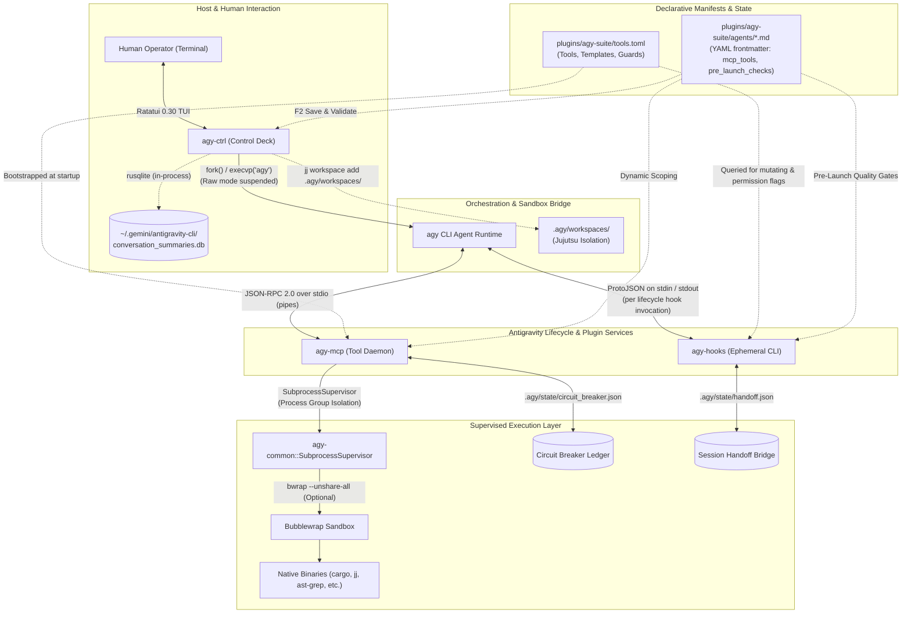

# agy-suite: System Architecture & Invariant Manual

**Document Version:** 1.0.0  
**Status:** Canonical & Permanent Architecture Specification  
**Authority:** Root repository manual for human developers and autonomous AI agents (`coder`, `planner`, `spec-checker`, `finisher`, `copilot`).

> **Quickstart & Usage:** For installation, terminal workflows, and the interactive control deck guide, see [README.md](README.md).  
> **Online Engine Manual:** For full documentation, guides, and tutorials, visit the [agy-suite Engine Manual](https://jeronimocapelle.github.io/agy-suite/).

---

## 1. System Invariants & Non-Negotiable Directives

All autonomous agents and human contributors operating within this repository or deploying `agy-suite` MUST adhere to the following invariants:

1. **Manifest Integrity (Strict Prohibition):**
   - **NEVER** autonomously edit `Cargo.toml`, `Cargo.lock`, or `deny.toml`.
   - Modifying dependencies or build configurations without human review is prohibited to prevent dependency bloat, accidental malicious package injection, and proc-macro execution vectors.
   - If a new dependency is required, the agent must ask the operator for permission with the package name, requested version, and justification before modifying manifests.
2. **Compiler & Linter Cleanliness:**
   - The codebase compiles under `#![deny(clippy::all)]` and `#![deny(clippy::pedantic)]`.
   - **Zero compiler warnings and zero clippy warnings** are tolerated across all workspace targets (`--all-targets`).
   - Every `#[allow(...)]` attribute requires an explicit `reason = "..."` explanation. Blanket crate-level lint suppressions are prohibited.
3. **Robust Error Handling:**
   - **Zero unhandled `unwrap()` or `expect()` calls** in production code. All errors must use typed enumerations (`thiserror`) or return descriptive `Result<T, String>` / `Result<T, AgyError>`.
4. **Subprocess Supervision & Hang Immunity:**
   - **Never** invoke raw synchronous `Command::new(...).output()` without timeout bounding.
   - All external processes must execute through `SubprocessSupervisor::run_supervised` with bounded deadlines (`agy-common::limits`) to prevent daemon or IDE freezes on lock contention or hanging processes.
5. **Pure Safe Rust & Process Group Safety:**
   - The entire codebase compiles with `#![forbid(unsafe_code)]`. Zero raw `libc` pointers or `unsafe` blocks are permitted.
   - Process tree containment and group signals are managed through safe process group abstractions (`command-group` and safe signal delivery), guaranteeing elimination of orphaned compiler tasks when parent processes exit.
6. **Thread Safety & Rust 2024 Compliance:**
   - **Zero** `std::env::set_var` or `remove_var` calls in production or test code. Parameterize environment lookups to prevent multithreaded data races.
7. **Fast Verification Standard:**
   - Use `cargo fast` (`cargo fast check`, `cargo fast clippy`, `cargo fast test`, `cargo fast build`) for rapid iteration powered by Cranelift and Mold.

---

## 2. The Three Declarative Contracts

`agy-suite` enforces a strict separation between **Platform Plumbing**, **Project Environment**, and **Agent Tooling**:

```
+-----------------------------------------------------------------------------------+
| 1. tools.toml (The Agent's Hands)                                                 |
|    - Declares MCP tools exposed to agents, base templates, actions, and limits.   |
|    - Language-agnostic declarative catalog with codeless gate execution.          |
+-----------------------------------------------------------------------------------+
| 2. hooks.toml (The Runtime's Rules)                                               |
|    - Declares lifecycle interception pipeline (<1ms native Rust execution).       |
|    - Circuit breaker strike logic, manifest mutation guards, conflict sentries.  |
|    - Declarative Turn 1 wake context injections ([[session_start.injections]]).   |
+-----------------------------------------------------------------------------------+
| 3. project.toml (The Codebase's Identity)                                         |
|    - Declarative contracts for the target repository.                             |
|    - Pre-invocation gates ([gates.<name>]), workspace containers, build cache     |
|      bind mounts, documentation paths, and security allow/deny rules.             |
+-----------------------------------------------------------------------------------+
```

### Hierarchy & Fallback Rules
- Workspace configuration always takes precedence: `<workspace>/.agy/project.toml` $\to$ `<workspace>/project.toml` $\to$ `<workspace>/plugins/agy-suite/project.toml`.
- When operating in an external repository without a `project.toml`, `agy-suite` falls back to a **blank, restrictive default configuration** rather than making language assumptions.

### 2.1 Engine vs. Reference Fleet Separation
`agy-suite` is fundamentally an **extensible, capability-governed engine and sandboxed MCP runtime**. The 10-agent fleet described in [Section 3](#3-agent-fleet-perimeters--blast-boundaries) represents the flagship reference implementation tailored for low-level systems engineering and Silicon Design Verification.

Any developer or autonomous AI can define bespoke fleets and tool catalogs for different languages and domains (e.g. Go, Python, TypeScript, or custom DSLs) simply by declaring a `.agy/` directory with `project.toml`, `tools.toml`, `hooks.toml`, and agent Markdown profiles (`agents/*.md`). Pre-built ecosystem starter kits are maintained in `docs/templates/` and documented in the [Engine Manual](https://jeronimocapelle.github.io/agy-suite/templates/overview.html).

---

## 3. Agent Fleet Perimeters & Blast Boundaries

Each agent in `plugins/agy-suite/agents/` operates under the **Air-Gapped Least-Privilege Model**, with boundaries and pre-launch checks unified directly in each agent's Markdown frontmatter:

| Agent Profile | Role & Responsibility | Permitted Directory & File Scope | Path & Content Policies | Mandatory Pre-Invocation Gates | Available Tooling & Operational Scope |
| :--- | :--- | :--- | :--- | :--- | :--- |
| **`coder.md`** | Production systems implementation (high-level Rust to bare-metal RISC-V & asm) | `allowed_dirs = ["src", "crates", "boards", "layout", "targets"]`<br>`disallowed_dirs = ["tests", "benches", "docs"]` | Masked manifests; asks operator for `Cargo.toml` dependency edits (`manifest_guard`) | `vcs_conflicts` | Full code mutation in source trees; compiler diagnostics, `mpatch_edit`, `write_file`, `search_codebase`, `read_project_file`, `cargo_check`, `cargo_test`, `cargo_clippy`. |
| **`copilot.md`** | Chief of Staff & Workflow Orchestrator | Strictly read-only code inspection (`disallowed_dirs = ["*"]`) | Read-only code inspection; workspace Jujutsu merge/rebase permitted | None | High-level fleet coordination across 4-phase lifecycle, subagent delegation, handoff inspection, Jujutsu workspace rebase/merge (zero direct code mutation). |
| **`doc-author.md`** | Technical docs & specification author | `allowed_dirs = ["docs", "specs", "src"]`<br>`allowed_files = ["README.md", "ARCHITECTURE.md"]`<br>`disallowed_dirs = ["tests", "benches"]` | `comments_only` path policy in `src/` (in-place `///` rustdoc without modifying code logic) | `vcs_conflicts` | API reference docs, pedagogical rustdoc (`///`, `//!`), register bitfield layouts, ASCII diagrams, RFCs, module structure, `cargo doc --no-deps`. |
| **`test-author.md`** | Design Verification (DV) & Formal Test Engineer | `allowed_dirs = ["tests", "benches", "src"]`<br>`disallowed_dirs = ["docs"]` | `tests_only` in `src/` (`mod tests` syntactic filter); asks operator for test deps | `vcs_conflicts` | Test runners (`nextest`, `mutants`, `insta`, `fuzz`), formal verification (`kani`), concurrency permutation (`loom`), memory safety (`miri`), compiler explanations, differential inspection (`llvm-objdump`). |
| **`planner.md`** | Architecture & Verification Strategy Rubber-Duck | `allowed_dirs = ["docs", ".scratchpad"]`<br>`allowed_files = ["ARCHITECTURE.md"]`<br>`disallowed_dirs = ["src", "tests", "benches"]` | Authoritative design documents & mandatory upfront verification plans | None | Read-only codebase queries, architecture editor, mandatory upfront verification strategy selection. Pre-injected with workspace crate topology. |
| **`finisher.md`** | Adversarial release gatekeeper | Strictly read-only across workspace (`disallowed_dirs = ["*"]`) | Zero mutation; pre-release gauntlet scorecard enforcement | `fmt`, `compilation`, `tests`, `vcs_conflicts` | Semantic diff review, pre-injected wake diff & changelog preview, binary size audit (`cargo_size`), supply-chain audit (`cargo_deny`), mutation scoring, mandated proof checks. |
| **`spec-checker.md`** | Spec-vs-code & ISA compliance auditor | Strictly read-only across workspace (`disallowed_dirs = ["*"]`) | Zero mutation; cross-references implementation against specs & ISA contracts | `vcs_conflicts` | Spec searches, ISA opcode checks, AST grep queries, active diff inspection (`inspect_workspace_diff`), clippy, cargo-deny, semver-checks. |
| **`perf-analyst.md`** | Microarchitectural profiler & benchmark engineer | `allowed_dirs = ["benches", "docs", ".agy/artifacts"]`<br>`disallowed_dirs = ["src", "tests"]` | Microbenchmarking, execution traces, latency distributions | `compilation`, `vcs_conflicts` | Profilers, Divan/Criterion benchmarks, flamegraphs, asm inspection, llvm-mca, hyperfine, bloat, section size & symbol mapping (`cargo-size`, `cargo-nm`). |
| **`mini.md`** | Narrow symbolic math & calculation specialist | Strictly air-gapped (`disallowed_dirs = ["*"]`) | Ephemeral scratchpad only; zero disk mutations | None | `eval_symbolic_math` (Python/SymPy) inside isolated container only. |
| **`sysadmin.md`** | High-reasoning Arch Linux system administrator | `allowed_dirs = ["*"]` (full system access) | Supervised shell; interactive operator confirmation (`ASK` / `[y/n]`) on all state-altering tools | None | Host troubleshooting, systemd, pacman inspection, `run_command`, `ask_question`. |

### Workspace Isolation
- Each agent operates in its own sparse Jujutsu workspace at `.agy/workspaces/<agent>/`.
- Agent modifications remain cleanly isolated from the operator's active `@` commit and open editor buffers.
- The shared build cache (e.g. `target/`) is symlinked to ensure compilation artifacts are shared without disk bloat.

---

## 4. The Four-Phase Fleet Lifecycle & Silicon Design Verification (DV) Framework

In low-level systems engineering (such as RISC-V processor cores, kernel runtimes, and lock-free concurrency engines), **formal correctness** and **performance optimization** are distinct disciplines with opposing feedback loops. `agy-suite` organizes autonomous agents into four structured phases:

```
  PHASE 1: CONTRACT & AUDIT           PHASE 2: IMPLEMENTATION & DV          PHASE 3: AUDIT & PROFILING
┌───────────────────────────┐       ┌───────────────────────────┐       ┌───────────────────────────┐
│        1. PLANNER         │       │         3. CODER          │       │      5. PERF ANALYST      │
│  - Debates architecture   │       │  - Sandboxed in src/**    │       │  - Latency & Throughput   │
│  - Mandates VERIFIERS     │       │  - Iterates to green tests│       │  - Cache lines & Flamelog │
│    (Loom, Kani, Miri)     │       └─────────────┬─────────────┘       │  - asm & llvm-mca ports   │
└─────────────┬─────────────┘                     │                     └─────────────┬─────────────┘
              │                                   ▼                                   │
              ▼                     ┌───────────────────────────┐                     ▼
┌───────────────────────────┐       │  4. VERIFICATION (DV)     │       ┌───────────────────────────┐
│      2. SPEC CHECKER      │       │  - Edge-case unit tests   │       │       6. FINISHER         │
│  - Audits ARCH against    │       │  - Kani proofs / Miri     │       │  - Mutation test audit    │
│    official specs & ISAs  │       │  - Loom concurrency tests │       │  - Mandated proof check   │
│  - Functional coverage bin│       │  - Differential oracles   │       │  - Clippy & Git diff audit│
└───────────────────────────┘       └───────────────────────────┘       └───────────────────────────┘
```

### Core Engineering Invariants:
1. **Upfront Verification Planning (Zero Timing Paradox):**
   - The Planner MUST declare the `Required Verification Strategy` in `ARCHITECTURE.md` during inception:
     * *Pure logic & bit-twiddling:* Kani formal proof (`cargo_kani`).
     * *Atomics & channels:* Loom C11 memory permutation harness (`cargo_loom`).
     * *Raw pointers & `#![no_std]` buffers:* Miri pointer provenance & Tree Borrows (`cargo_miri`).
     * *Instruction decoders (e.g. RISC-V):* Differential execution against reference models or `llvm-objdump` (`llvm_objdump`).
   - Late-stage verification tool discovery at release is strictly forbidden.
2. **The Silicon Design Verification (DV) Split:**
   - Under hardware discipline (ASIC/RISC-V design), the engineer who writes implementation logic **never** authors the verification testbench.
   - `test-author` (DV Engineer) authors adversarial test harnesses to actively break the system.
   - `coder` has read-only access to `tests/` and write access strictly to `src/**`, preventing test tampering or assertion weakening.
3. **Differential Oracles Over Hardcoded Asserts:**
   - For instruction sets and binary protocols, tests generate instruction bitstreams, run them through custom execution logic, and assert register state equality against an external disassembler (`llvm-objdump`) or reference simulator.
4. **Functional Coverage Bins Over Line Coverage:**
   - Tests must target state-space coverage bins (e.g. shift operations with sign-bit 1 vs 0, page-boundary memory crossings, interrupt cycle transitions, privilege register bitfields) rather than superficial line counts.
5. **Mutation Testing Gate (`cargo mutants`):**
   - Autonomous tests are validated via mutation scoring (`cargo_mutants`). Any test suite where synthetic mutants survive is rejected as ineffective/tautological.
6. **Purification of Performance Profiling:**
   - `perf-analyst` strictly measures throughput, latency distributions, CPU execution pipeline ports (`llvm_mca`), disassembly (`cargo_asm`), cache misses (`cargo_perf`), and binary size (`cargo_bloat`). It is entirely decoupled from correctness/UB tools.
7. **Unified Systems Implementation & Documentation Separation:**
   - Systems implementation across all abstraction tiers—from high-level business logic down to bare-metal RISC-V initialization, linker scripts (`link.ld`, `memory.x`), section allocation (`.text`, `.data`, `.bss`), and inline assembly—is unified in `coder`.
   - Technical rustdoc (`///`), architectural RFCs, register bitfield diagrams, and specifications are authored by `doc-author`.
8. **Deterministic Pre-Release Gauntlet (`pre_release_gauntlet`):**
   - Rather than executing 6–8 sequential CLI commands across multiple LLM turns, the release gatekeeper executes `pre_release_gauntlet` in a single shot. This evaluates VCS conflicts, unit/integration tests, clippy `-D warnings`, rustfmt check, ancillary targets, and doc build in one pass, outputting a consolidated scorecard.

---

## 5. Subagent Admission & Quality Gatekeeping

When `invoke_subagent` is called, `agy-hooks` evaluates the `subagent_admission` gate before the subagent can boot:
1. Target agent's frontmatter `pre_launch_checks: [...]` is extracted.
2. Gates are evaluated:
   - Built-in VCS conflict check (`vcs_conflicts` blocks invocation if merge conflict markers are detected).
   - Built-in workspace cleanliness check (`workspace_clean`).
   - Declarative project gates matched against `project.toml [gates.<name>]` (e.g. `compilation`, `tests`, `linter`, `fmt`). Any gate check (such as code formatters or test suites) can be configured purely in TOML without modifying compiled Rust binaries.
3. If any gate check fails:
   - Admission is **denied** before burning LLM tokens.
   - Diagnostic output is returned to the calling agent with specific failure lines to guide remediation.

### 5.1 Declarative Wake Context Injections (`[[session_start.injections]]`)

To prevent autonomous agents from wasting 5–10 LLM turns and tens of thousands of tokens running repetitive CLI commands on wake-up:
1. `hooks.toml` defines declarative wake injections matching agent names or patterns:
   - **`copilot`**: Injects active Jujutsu working copy and commit status (`jj status --no-pager`) so it greets the user with immediate situational awareness.
   - **`planner`**: Injects workspace crate topology (`cargo tree --depth 0 --workspace`) so it immediately knows all member crates and paths.
   - **`spec-checker`**: Injects uncommitted file modifications (`git status --short`) pinpointing modified files awaiting spec auditing.
   - **`finisher`**: Injects active workspace diff summary (`jj diff --summary`), parent revision stats (`jj show @- --stat`), git status (`git status --short`), and recent unreleased Conventional Commits changelog (`git-cliff`).
2. When any matched agent is invoked, `agy-hooks` intercepts `SessionStart` (Turn 1), executes the configured command under strict timeouts, bounds the output line count, and injects the live ground truth directly into the agent's wake prompt.
3. The agent starts Turn 1 with immediate awareness of essential ground truth without firing a single MCP tool call.

---

## 6. Security & Filesystem Confinement

Enforced across all tools (`read_project_file`, `write_file`, `modify_code`, `search_codebase`):

1. **Path Traversal Defense:** Absolute paths outside the workspace and relative escapes (`../`) are rejected.
2. **Sensitive File Protection:**
   - Generic credentials (`password`, `secret`, `token`, `credential`, `api_key`).
   - VCS internals (`.git`, `.jj`, `.hg`, `.svn`).
   - SSH private keys (`id_rsa`, `id_ed25519`, `id_ecdsa`).
   - Shell profiles (`.bashrc`, `~/.zshrc`, `.profile`).
   - Sensitive cryptographic extensions (`.key`, `.pem`, `.pfx`, `.p12`, `.keystore`).
   - Configurable per-project via `project.toml [security]`.
3. **Manifest Mutation Guard:**
   - Intercepts mutating tools targeting build scripts (`build.rs`, `Cargo.toml`, `package.json`, `CMakeLists.txt`, `Makefile`).
   - Neutralizes procedural macro and build-script host code execution vulnerabilities.

---

## 7. Directory Layout of the Repository

```
agy-suite/
├── ARCHITECTURE.md     # Canonical system architecture and invariant manual (this file)
├── README.md           # Repository overview, visual workflow, and quickstart guide
├── Cargo.toml          # Workspace root manifest (strict pedantic lints, zero warnings)
├── deny.toml           # Supply-chain security, RustSec advisories, and license policy
├── install.sh          # Self-contained bundle builder & Gemini plugin installer
├── .github/workflows/  # Continuous Integration (cargo check, cargo test, clippy -D warnings)
├── crates/             # Native 4-crate Rust workspace
│   ├── agy-common/     # Core domain models, project config, supervisor, Jujutsu, state
│   ├── agy-mcp/        # Declarative MCP server, tool execution engine, agent guards
│   ├── agy-hooks/      # High-assurance lifecycle interceptors (<1ms native execution)
│   └── agy-ctrl/       # Ratatui 0.30 TUI dashboard, fleet matrix, and session explorer
└── plugins/
    └── agy-suite/      # Self-contained Antigravity plugin distribution bundle
        ├── plugin.json # Host manifest
        ├── hooks.json  # Host lifecycle hook bindings
        ├── project.toml# Declarative project contracts and multi-language scaffolds
        ├── hooks.toml  # Lifecycle interception pipeline and circuit breaker rules
        ├── tools.toml  # Declarative MCP tool catalog and agent perimeters
        ├── README.md   # Plugin documentation and customization cookbook
        ├── bin/        # Native binaries and acceleration helpers (cargo-fast, agy-*)
        └── agents/     # Fleet specifications (coder, copilot, doc-author, finisher, etc.)
```

---

## 8. High-Assurance Systems Architecture: The 4 Crates & Sandboxing

### High-Level Topology



### 8.1 The 4 Crates Architecture
1. **`agy-common` (Systems Foundation):**
   - **`SubprocessSupervisor`:** Enforces process tree lifecycle containment via safe process group isolation (`command-group`) and safe signal delivery. Guaranteed elimination of orphaned compiler tasks when parent processes exit.
   - **`JujutsuWorkspace`:** Dynamic management of isolated Jujutsu workspaces at `.agy/workspaces/<agent>/`, snapshotting, and atomic rebase/squash merging with rollback (`jj op restore`).
   - **`ContentFilter`:** Language-agnostic syntactic path policies (`comments_only`, `tests_only`, `delimited`) preventing cross-boundary modifications during autonomous runs.
   - **`AgyStatePaths`:** Canonical management of `.agy/` state directories, circuit breaker ledgers, and handoff bridges.
2. **`agy-mcp` (Declarative Model Context Protocol Daemon):**
   - Implements native Model Context Protocol (MCP 2024-11-05) over stdio JSON-RPC.
   - Dynamically parses `tools.toml`, synthesizes strict JSON Schemas, validates parameters against regex constraints, and enforces agent perimeter allowlists.
   - Powered by 10 native action handlers: bounded file reading, atomic writing, `mpatch` fuzzy SEARCH/REPLACE block edits, in-process file search, parameterized CLI execution, compiler NDJSON diagnostic extraction, in-process manuals, project state inspection, and Jujutsu workspace lifecycle isolation.
3. **`agy-hooks` (Featherweight Interception Runner):**
   - Ultra-fast native CLI (<1ms startup, <500KB RSS) executing Antigravity lifecycle events: `detect-wip`, `check-conflicts`, `check-subagent`, `enforce-tool-policy`, `record-handoff`, and `inject-wake`.
   - Protects critical build manifests (`Cargo.toml`) via `manifest_guard` and tracks consecutive compiler failure strikes via `circuit_breaker`.
4. **`agy-ctrl` (Interactive Ratatui 0.30 Terminal Deck):**
   - Standalone terminal dashboard providing interactive Fleet Matrix navigation, declarative tool catalog inspection, real-time circuit breaker status with single-key reset (`c` / `Shift-K`), and SQLite session resumption.

### 8.2 Bubblewrap Container-Grade Sandboxing
- Untrusted execution (such as SymPy mathematical evaluation in `eval_symbolic_math`) is precision-jailed inside Bubblewrap (`bwrap --unshare-all`).
- Runs with completely private PID, IPC, and network namespaces (`CLONE_NEWNET`, private loopback only, zero external sockets).
- Filesystem mounted as read-only with a synthetic in-memory `tmpfs` root, eliminating host filesystem leakage or data exfiltration.

### 8.3 External Tool Integrations
- Optional external tools (such as Tree-sitter AST code graph engines or systems trace visualizers) can be discovered via `$PATH` when installed on the host system.

### 8.4 Native MCP Access Points & Execution Guarantees
The `agy-mcp` daemon replaces ambient shell access with 10 hardened native action handlers:
1. **`file_read`:** Bounded file reader with line-range slicing (`start_line`, `end_line`) and UTF-8-safe byte caps.
2. **`file_write`:** Atomic writer enforcing directory perimeters and syntactic path policies.
3. **`mpatch_edit`:** Precision fuzzy block patcher (`<<<< SEARCH / ==== / >>>> REPLACE`) eliminating destructive full-file rewrites.
4. **`file_search`:** In-process fast regex/substring pattern search across repository files and project doc trees without external dependencies.
5. **`static_command`:** Parameterless invocation of fixed audit binaries (`cargo check`, `cargo test`, `git status`).
6. **`parameterized_command`:** Bounded execution with strict per-argument regex allowlists (`regex = "^[a-zA-Z0-9_\\-\\.]+$"`).
7. **`cli_manual`:** In-process system manual provider synthesizing `navi` cheat sheets, `tldr` summaries, manpage synopsis blocks, `--help` buffers, and `rustc --explain` references directly into the agent's context.
8. **`project_state`:** In-process VCS status, branch detection, and uncommitted change inspector.
9. **`workspace_ensure` / `workspace_inspect` / `workspace_merge`:** Jujutsu workspace lifecycle isolation handlers managing isolated branch revisions off `default@`.

---

## 9. Deep Systems Verification & Hardware Analysis Toolchain

`agy-suite` incorporates a battle-tested systems engineering and silicon verification toolchain:

| Domain | Tools & Frameworks | Architectural Purpose |
| :--- | :--- | :--- |
| **Compiler & Fast Path** | Cranelift, Mold, `cargo fast`, `sccache`, `zigbuild` | Sub-second dev iteration; Cranelift code generation + Mold linking for instant checks. |
| **Formal Verification** | `kani`, `miri` | Bit-precise model checking and SAT/SMT proofs (`kani`); Stacked/Tree Borrows UB detection (`miri`). |
| **Concurrency Testing** | `loom` | Exhaustive permutation testing of atomic memory orderings and lock-free data structures. |
| **Property & Mutation** | `proptest`, `cargo-fuzz`, `cargo-mutants`, `cargo-careful` | Generative property testing, libFuzzer fuzzing, mutation coverage, and extra UB checks. |
| **Trace & Microarchitecture** | `perfetto-mcp-rs`, `graphtrail`, `perf`, `llvm-mca`, `samply`, `flamegraph` | Kernel scheduler switch analysis (`.pftrace`), AST code intelligence, pipeline latency, CPU profiling. |
| **Benchmarking & Memory** | `hyperfine`, `criterion`, `divan`, `dhat`, `valgrind`, `bacon` | Statistical CLI benchmarks, microbenchmarks, heap allocation profiling, memory leak detection. |
| **Low-Level & Hardware** | `gdb`, `lldb`, `strace`, `qemu`, `nasm`, `zig`, `cargo-asm`, `cargo-bloat` | Kernel syscall tracing, ISA emulation, assembly inspection, and binary footprint analysis. |
| **Supply Chain & API Gates**| `cargo-deny`, `cargo-audit`, `cargo-machete`, `cargo-semver-checks`, `cargo-public-api`, `cargo-hack` | License/CVE compliance, unused dependency elimination, semver drift detection, and multi-target checks. |

---

## 10. Zero-Skill Architecture & Sandboxing Continuum

### 10.1 The Zero-Skill Policy (`NO SKILL.md`)
Google Antigravity natively supports markdown-based skills (`SKILL.md`) and unconfined bash wrappers. In production systems engineering, this approach exhibits severe defects:
- **Token Inefficiency:** Injecting multi-kilobyte markdown definitions consumes 2,000 to 4,000+ baseline tokens per conversational turn.
- **Unconfined Injection Surface:** Bash-based skills execute in ambient shells without argument bounds, timeouts, or output truncation.
- **`agy-suite` Solution:** Completely bans interpreted markdown skills. All agent capabilities are declared as native, compiled MCP handlers or bounded static commands with strict JSON Schemas, reducing prompt overhead to zero baseline tokens and guaranteeing deterministic execution bounds.

### 10.2 Four-Tier Security Continuum
```
[ Level 1: Operator Cockpit (agy-ctrl) ]
  └── Policy switches, model effort controls, interactive ASK gate enforcement
        │
[ Level 2: Runtime Engine (agy --sandbox) ]
  └── Host LLM & Web Search connectivity retained; local filesystem mutations constrained
        │
[ Level 3: Precision Tool Isolation (bwrap --unshare-all) ]
  └── enforce_sandbox = true: Private mount/PID/IPC/network namespaces, loopback only, zero raw sockets
        │
[ Level 4: Path & Manifest Guard (manifest_guard & ContentFilter) ]
  └── Cargo.toml / .env / SSH keys protected; inner-file boundary filters (mod tests only)
```

---

## 11. Operational Protocols & Fleet Governance

The operational boundaries defined in [Section 3: Agent Fleet Perimeters & Blast Boundaries](#3-agent-fleet-perimeters--blast-boundaries) are enforced through declarative runtime protocols:

### 11.1 The Dependency Request Protocol
When an implementing agent (`coder` or `test-author`) requires a third-party dependency:
1. Direct editing of `Cargo.toml`, `Cargo.lock`, or `deny.toml` is intercepted and blocked by `manifest_guard`.
2. The agent asks the human operator directly with the package name, requested version, features, and justification.
3. Once the operator approves, the dependency can be added to the manifest.

### 11.2 Jujutsu Workspace Isolation & Clean State Invariants
- Each agent operates in its own sparse Jujutsu working copy at `.agy/workspaces/<agent>/`.
- Agent modifications remain cleanly isolated from the operator's active `@` commit and open editor buffers.
- Merging and rebasing workspace revisions is governed by `copilot` and the `SubagentAdmissionGate` without mutating active work-in-progress.
