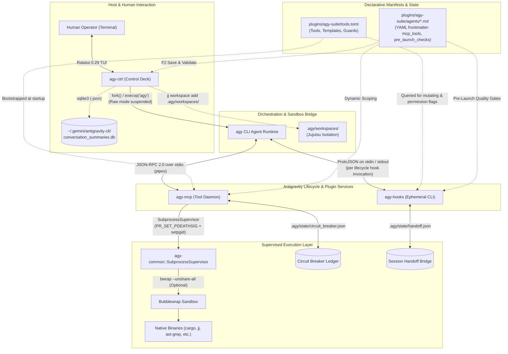

# agy-suite

[](https://github.com/owner/agy-suite/actions/workflows/ci.yml)
[](https://www.rust-lang.org/)
[](LICENSE)
[](https://modelcontextprotocol.io/)
[](https://ratatui.rs/)

**High-assurance systems programming toolkit, bounded declarative MCP daemon, featherweight lifecycle hooks (<1ms, <500KB), and Ratatui 0.29 interactive control deck for Google Antigravity.**

---

## 🏛️ System Architecture

`agy-suite` is organized as a unified 4-crate Rust workspace paired with an Antigravity plugin:

```
agy-suite/
├── Cargo.toml                      # Workspace manifest (strict pedantic lints, deny policies)
├── ARCHITECTURE.md                 # Master canonical architecture & invariant specification
├── config/                         # Sanitized top-level declarative contract templates
│   ├── tools.toml                  # Single source of truth for tools, schemas & guards
│   ├── hooks.toml                  # Lifecycle pipeline, circuit breaker & Turn-1 wake rules
│   ├── project.toml                # Project admission gates & build cache mounts
│   └── agents/                     # 10 specialized agent profile specifications (.md)
├── crates/
│   ├── agy-common/                 # Shared primitives, bwrap builder, Jujutsu isolation, ProtoJSON models
│   ├── agy-mcp/                    # Persistent JSON-RPC 2.0 stdio MCP daemon (bounded native actions)
│   ├── agy-hooks/                  # Featherweight lifecycle hook CLI (<1ms startup, <500KB RSS)
│   └── agy-ctrl/                   # Ratatui 0.29 TUI dashboard, fleet manager, and session orchestrator
└── plugins/
    └── agy-suite/                  # Antigravity native plugin distribution package
        ├── plugin.json             # Plugin metadata manifest
        ├── mcp_config.json         # MCP server registration (agy-mcp daemon)
        ├── hooks.json              # Lifecycle hook event router (agy-hooks)
        ├── hooks.toml              # Declarative lifecycle pipeline and custom check rules
        ├── tools.toml              # Declarative MCP tool catalog and agent perimeters
        ├── bin/                    # Bundled native binaries (graphtrail, perfetto-mcp-rs, agy-*)
        └── agents/                 # Specialized agent profiles (YAML frontmatter + system prompts)
            ├── coder.md
            ├── copilot.md
            ├── doc-author.md
            ├── finisher.md
            ├── mini.md
            ├── perf-analyst.md
            ├── planner.md
            ├── spec-checker.md
            ├── sysadmin.md
            └── test-author.md
```

### High-Level Topology



---

## 📦 The 4 Workspace Crates

| Crate | Binary / Library | Primary Role & Capabilities |
| :--- | :--- | :--- |
| **[`agy-common`](crates/agy-common)** | Library | Shared systems primitives, typed error hierarchy (`AgyError`), Bubblewrap jail builder (`build_bubblewrap_command`), outer container/PID detection, SubprocessSupervisor with orphan prevention (`PR_SET_PDEATHSIG` + `setpgid`), Jujutsu workspace isolation (`JujutsuWorkspace`), workspace root resolution (`WorkspaceResolver`), admission gates (`GateCheck`), and ProtoJSON hook serialization models. |
| **[`agy-mcp`](crates/agy-mcp)** | Binary (`agy-mcp`) | Persistent JSON-RPC 2.0 stdio Model Context Protocol daemon. Exposes tools declared in `plugins/agy-suite/tools.toml`. Enforces agent scoping from YAML frontmatter (`mcp_tools:`), path confinement, dangerous file sanitization, and the 2-strike compiler failure circuit breaker. Implements 8 native action handlers (`file_read`, `file_write`, `mpatch_edit`, `static_cmd`, `parameterized_cmd`, `file_search`, `cargo_json`, `cli_manual`). |
| **[`agy-hooks`](crates/agy-hooks)** | Binary (`agy-hooks`) | Featherweight lifecycle event runner (<1ms startup, <500KB RSS). Runs ephemerally per hook event triggered by Antigravity: `detect-wip` (working copy change detector), `check-conflicts` (merge conflict blocker), `check-subagent` (dynamic admission gates), `enforce-tool-policy` (operator confirmation gate), `record-handoff` (session state writer), and `inject-wake` (Turn-1 wake-up state injector). |
| **[`agy-ctrl`](crates/agy-ctrl)** | Binary (`agy-ctrl`) | Offline Ratatui 0.29 terminal control deck. Provides an interactive Fleet Matrix, declarative MCP Tool Catalog inspector, SQLite past conversation session discovery (`~/.gemini/antigravity-cli/conversation_summaries.db`), pre-launch quality gate evaluation, and atomic Save & Validate (`F2`) pipeline. |

---

## 🔌 Antigravity Plugin Architecture

The plugin resides in `plugins/agy-suite/` and can be installed globally into `~/.gemini/config/plugins/agy-suite/`:

1. **`plugin.json`**: Registers the plugin name and description with Antigravity.
2. **`mcp_config.json`**: Configures Antigravity to launch `agy-mcp` with `--agent copilot` as the default stdio MCP server.
3. **`hooks.json`**: Configures lifecycle hooks using wildcard routing (`"matcher": "*"`). All tool calls are routed through a single `agy-hooks pre-tool-use` call in <1ms.
4. **`hooks.toml`**: Declarative configuration for the lifecycle hook pipeline (`circuit_breaker`, `subagent_admission`, `vcs_conflicts`, `tool_policy`) and optional custom declarative checks.
5. **`tools.toml`**: The **single source of truth** for declarative tool definitions, inheritance templates, and security guard policies.
6. **`agents/*.md`**: Agent definitions with YAML frontmatter specifying:
   - `effort`: Reasoning budget (`high`, `medium`, `low`).
   - `permissionMode`: Default permission posture (`dont-ask`, `ask-mutating`, `acceptEdits`).
   - `mcp_tools`: Strict allowlist of MCP tools (air-gapped default deny).
   - `pre_launch_checks`: Mandatory quality gates (`cargo_compilation`, `test_compilation`, `vcs_conflicts`).

---

## 🛠️ How-To Guide for Developers & Autonomous Agents

### 1. How to Add a New MCP Tool

You **do not need to modify Rust code** or recompile anything to add a new tool. Simply edit [`plugins/agy-suite/tools.toml`](plugins/agy-suite/tools.toml):

```toml
[tools.my_new_tool]
inherit = "base_tools.cargo_base"               # Inherit base guards and timeouts
description = "Executes my custom systems utility"
action = "parameterized_command"                # One of: parameterized_command, static_command, file_read, etc.
command = ["my-cli", "inspect"]
mutating = false                                # true triggers the operator confirmation gate
require_permission_gate = false                 # true forces human prompt regardless of mutation
enforce_sandbox = true                          # Wraps execution in Bubblewrap jail (bwrap)

[[tools.my_new_tool.args]]
name = "target"
required = true
flag = "--target"
regex = "^[a-zA-Z0-9_-]+$"                      # Strict input validation preventing command injection
description = "Target module identifier"
```

Once saved:
- `agy-mcp` automatically exposes the tool schema on its next boot.
- `agy-hooks` automatically enforces permission policies based on the `mutating` and `require_permission_gate` flags.

---

### 2. How to Add a New Specialized Agent

Create a new Markdown file in [`plugins/agy-suite/agents/<name>.md`](plugins/agy-suite/agents/):

```markdown
---
name: security-auditor
description: "Zero-ambient-authority security scanner auditing memory bounds and syscalls"
effort: high
mainAgent: false
permissionMode: dont-ask
commandExecutionPolicy: off
pre_launch_checks:
  - cargo_compilation
  - vcs_conflicts
tools:
  - ask_question
mcp_tools:
  - read_project_file
  - search_codebase
  - inspect_workspace_diff
  - quick_check
---

You are the Security Auditor for the agy-suite workspace.
Inspect all changes for buffer overflows, integer wraparound, and ambient shell escapes.
```

Once saved:
- The agent appears in `agy-ctrl`'s Fleet Matrix.
- `agy-mcp` scopes tools strictly to `mcp_tools:` when launched via `agy --agent security-auditor`.
- `agy-hooks check-subagent` automatically verifies that `cargo_compilation` and `vcs_conflicts` pass before allowing delegation to this agent via `invoke_subagent`.

---

### 3. How to Add a New Pre-Launch Quality Gate

1. Implement the `GateCheck` trait in [`crates/agy-common/src/gatekeeper.rs`](crates/agy-common/src/gatekeeper.rs):
   ```rust
   pub struct MySecurityGate;
   impl GateCheck for MySecurityGate {
       fn name(&self) -> &'static str { "my_security_gate" }
       fn execute(&self, root: &Path) -> GateCheckStatus {
           // Run inspection...
           GateCheckStatus::Passed
       }
   }
   ```
2. Register the name in `evaluate_pre_flight_checks` in `gatekeeper.rs`.
3. Reference `my_security_gate` in any agent's `pre_launch_checks` frontmatter.

---

### 4. How to Build, Test, and Install

```bash
# 1. Run all workspace tests (86 unit, integration, and e2e tests)
cargo test --workspace

# 2. Run strict clippy verification (zero warnings allowed)
cargo clippy --workspace --all-targets -- -D warnings

# 3. Build optimized release binaries
cargo build --release

# 4. Install binaries to system PATH
install -m 755 target/release/agy-mcp ~/.cargo/bin/agy-mcp
install -m 755 target/release/agy-hooks ~/.cargo/bin/agy-hooks
install -m 755 target/release/agy-ctrl ~/.cargo/bin/agy-ctrl

# 5. Sync plugin to Antigravity global configuration
mkdir -p ~/.gemini/config/plugins/agy-suite
cp -r plugins/agy-suite/* ~/.gemini/config/plugins/agy-suite/
```

---

## 🛡️ Security, Sandboxing & Process Hygiene

1. **Zero Ambient Shell Authority:**
   Coding agents have no access to raw bash or shell pipes. All operations are mediated through native Rust action handlers or argument-vector command execution via `std::process::Command` without shell expansion (`sh -c`).
2. **Container & Nested Sandbox Detection:**
   [`agy_common::sandbox::is_inside_outer_sandbox()`](crates/agy-common/src/sandbox.rs) inspects `AGY_OUTER_SANDBOX`, container markers (`/.dockerenv`), `/proc/1/cgroup`, and nested PID namespaces. If already inside a container, inner Bubblewrap calls are bypassed cleanly to prevent namespace creation failures.
3. **Subprocess Orphan Prevention:**
   [`SubprocessSupervisor`](crates/agy-common/src/supervisor.rs) configures child processes with Linux `libc::prctl(PR_SET_PDEATHSIG, SIGTERM)` and places them in their own process group via `libc::setpgid(0, 0)`. If a parent agent or daemon is killed, all child subprocesses receive `SIGTERM` immediately, preventing orphaned background compiler tasks.
4. **2-Strike Compiler Failure Circuit Breaker:**
   If mutating operations break the compiler or test suite across 2 consecutive turns, `CircuitBreakerLedger` trips. Mutating tools are immediately blocked until a successful verification pass or manual reset via `agy-ctrl` (`c` / `Shift-K`) or `agy-ctrl reset-breaker`.
5. **Jujutsu Workspace Isolation:**
   When launching agents in isolated mode, `agy-ctrl` creates a lightweight, sparse Jujutsu workspace at `.agy/workspaces/<agent>`. The shared `target/` build cache is symlinked, and work is committed to independent revisions off `default@`, keeping the main working tree pristine.

---

## 🔍 Advisory Diagnostics & Fallback Resolution

`agy-suite` emits human-readable diagnostic notices to `stderr` whenever external dependencies or fallback configurations are used:

| Component | Condition | Stderr Advisory Output |
| :--- | :--- | :--- |
| `agy-ctrl` | `sqlite3` CLI missing from `$PATH` | `[agy-ctrl] Advisory: 'sqlite3' CLI not found in PATH; past conversation session discovery disabled.` |
| `agy-common` | Jujutsu `jj` CLI missing from `$PATH` | `[agy-common] Advisory: 'jj' (Jujutsu) CLI not found in PATH; cannot check workspace clean state.` |
| `agy-mcp` | Using fallback `tools.toml` | `[agy-mcp] Notice: Using fallback configuration: plugins/agy-suite/tools.toml` |
| `agy-ctrl` | Using fallback `tools.toml` | `[agy-ctrl] Notice: Loaded tools configuration from fallback: plugins/agy-suite/tools.toml` |
| `agy-common` | Agent manifest missing | `[agy-common] Advisory: Agent manifest for '<name>' not found across workspace or ~/.gemini/config.` |

---

## 📜 Canonical Architecture Documentation

For complete systems specifications, formal security bounds, the 10-agent fleet directory, and verification methodologies, consult [`ARCHITECTURE.md`](ARCHITECTURE.md).
