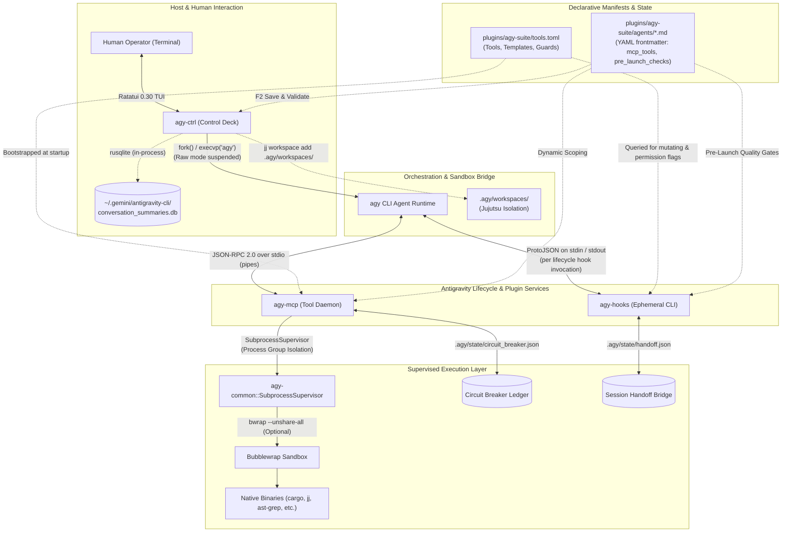

# agy-suite

[](https://github.com/JeronimoCapelle/agy-suite/actions/workflows/ci.yml)
[](https://www.rust-lang.org/)
[](LICENSE)
[](https://jeronimocapelle.github.io/agy-suite/)
[](https://modelcontextprotocol.io/)
[](https://ratatui.rs/)

**High-assurance systems programming toolkit, bounded declarative MCP daemon, featherweight lifecycle hooks (<1ms, <500KB), and Ratatui 0.30 interactive control deck for Google Antigravity.**

<!-- VHS Terminal Recording Skeleton (Run `vhs assets/demo.tape` to update) -->
<p align="center">
  
</p>

---

## ⚡ Quickstart (One-Liner)

Install the full suite and register the Antigravity plugin with a single command (no prior cloning required):

```bash
curl -sSL https://raw.githubusercontent.com/JeronimoCapelle/agy-suite/main/install.sh | bash
```

*(Tip: For fast local development using Cranelift + Mold, append `-s -- --fast`).*

Or clone and build manually from source:

```bash
git clone https://github.com/JeronimoCapelle/agy-suite.git
cd agy-suite
./install.sh --fast
```

Then boot the interactive flight deck in any repository:
```bash
agy-ctrl
```

---

## ⚖️ Why This Exists (The Problem & The Solution)

Autonomous coding agents are powerful, but raw terminal execution in production systems is inherently dangerous, non-deterministic, and token-inefficient.

| Challenge in Raw AI Coding | How `agy-suite` Solves It |
| :--- | :--- |
| **Ambient Shell Poisoning:** Agents run unstructured `bash` commands with full host access, risking accidental `rm -rf`, network leaks, or credential corruption. | **Configurable Container Sandboxing:** Run entire sessions jailed via `agy-ctrl` (toggle with `b`/`F8`) or declare `enforce_sandbox = true` per individual tool in `tools.toml`. |
| **Token Exhaustion:** Inlining multi-kilobyte prompt instructions and tool manuals burns ~2,000–5,000 tokens on every single model turn. | **Compiled Native Interceptors:** Bounded Rust daemons (<1ms, <500KB RSS) handle tool execution, regex sanitization, and output truncation offline. |
| **Lost Conversation State:** Terminal drops or shell restarts lose the active conversational thread, forcing users to re-prompt from scratch. | **Multi-Source Session Resumption:** Embedded SQLite & history correlation automatically surfaces resumable sessions (`[Enter/r: Resume]`). |
| **Branch Pollution:** Unsupervised model edits pollute the developer's working directory and editor buffers with uncommitted changes. | **Jujutsu Isolated Workspaces:** Agents operate in isolated `.agy/workspaces/<agent>` working copies without ever mutating the developer's main `@` revision. |

---

## 💡 About `agy-suite`

Autonomous AI coding agents frequently suffer from two fatal failure modes in production systems engineering: **ambient shell poisoning** (unrestricted subshell injection, accidental `rm -rf`, credential leakage) and **token exhaustion** (re-injecting multi-kilobyte interpreted markdown skills on every turn).

`agy-suite` (Antigravity Systems Suite) is an enterprise-grade, capability-based orchestration platform written in pure Safe Rust (Rust 2024 Edition, `#![forbid(unsafe_code)]`). Built as a hardened extension layer for Google Antigravity (`agy`), it replaces non-deterministic ambient shell access with:

- **Configurable Container Sandboxing:** Ephemeral Bubblewrap (`bwrap`) isolation with private loopback, unmounted network capability, read-only system roots, and credential masking—toggleable per-session in `agy-ctrl` (<kbd>b</kbd> / <kbd>F8</kbd>) or declaratively enforced per-tool in `tools.toml`.
- **Declarative MCP Tooling (`agy-mcp`):** Native JSON-RPC stdio daemon with regex parameter sanitization, bounded UTF-8 output slicing, and dynamic agent allowlists.
- **Compiled Lifecycle Interceptors (`agy-hooks`):** Sub-millisecond (<1ms, <500KB RSS) execution gates featuring an automated 2-strike compiler circuit breaker and Turn-1 context wake injections.
- **Interactive Flight Cockpit (`agy-ctrl`):** Ratatui 0.30 terminal dashboard for live policy matrix navigation, SQLite session resumption, and pre-flight gatekeeping.
- **Specialized 10-Agent Fleet:** Distinct operational personas (`coder`, `finisher`, `planner`, `test-author`, `perf-analyst`, etc.) with inner-file boundary filters and explicit human-in-the-loop dependency request gates.

---

## 🏛️ System Architecture

`agy-suite` is organized as a unified 4-crate Rust workspace paired with an Antigravity plugin:

```
agy-suite/
├── Cargo.toml                      # Workspace manifest (strict pedantic lints, deny policies)
├── ARCHITECTURE.md                 # Master canonical architecture & invariant specification
├── install.sh                      # Self-contained bundle builder & Gemini plugin installer
├── crates/
│   ├── agy-common/                 # Shared primitives, bwrap builder, Jujutsu isolation, ProtoJSON models
│   ├── agy-mcp/                    # Persistent JSON-RPC 2.0 stdio MCP daemon (bounded native actions)
│   ├── agy-hooks/                  # Featherweight lifecycle hook CLI (<1ms startup, <500KB RSS)
│   └── agy-ctrl/                   # Ratatui 0.30 TUI dashboard, fleet manager, and session orchestrator
└── plugins/
    └── agy-suite/                  # Antigravity native plugin distribution package
        ├── plugin.json             # Plugin metadata manifest
        ├── hooks.json              # Lifecycle hook event router (agy-hooks)
        ├── hooks.toml              # Declarative lifecycle pipeline and custom check rules
        ├── tools.toml              # Declarative MCP tool catalog and agent perimeters
        ├── project.toml            # Declarative quality gates and cache mounts
        ├── bin/                    # Bundled native binaries (graphtrail, perfetto-mcp-rs, agy-*)
        └── agents/                 # Specialized agent profiles (YAML frontmatter + system prompts)
            ├── coder.md
            ├── copilot.md
            ├── doc-author.md
            ├── finisher.md
            ├── mini.md
            ├── perf-analyst.md
            ├── planner.md
            ├── spec-checker.md
            ├── sysadmin.md
            └── test-author.md
```

### High-Level Topology



---

## 📦 The 4 Workspace Crates

| Crate | Binary / Library | Primary Role & Capabilities |
| :--- | :--- | :--- |
| **[`agy-common`](crates/agy-common)** | Library | Shared systems primitives, typed error hierarchy (`AgyError`), Bubblewrap jail builder (`build_bubblewrap_command`), outer container/PID detection, SubprocessSupervisor with process group isolation and timeout supervision, Jujutsu workspace isolation (`JujutsuWorkspace`), workspace root resolution (`WorkspaceResolver`), admission gates (`GateCheck`), and ProtoJSON hook serialization models. |
| **[`agy-mcp`](crates/agy-mcp)** | Binary (`agy-mcp`) | Persistent JSON-RPC 2.0 stdio Model Context Protocol daemon. Exposes tools declared in `plugins/agy-suite/tools.toml`. Enforces agent scoping from YAML frontmatter (`mcp_tools:`), path confinement, dangerous file sanitization, and the compiler failure circuit breaker. Implements native action handlers (`file_read`, `file_write`, `mpatch_edit`, `file_search`, `static_command`, `parameterized_command`, `cli_manual`, `project_state`, `workspace_*`). |
| **[`agy-hooks`](crates/agy-hooks)** | Binary (`agy-hooks`) | Featherweight lifecycle event runner (<1ms startup, <500KB RSS). Runs ephemerally per hook event triggered by Antigravity: `detect-wip` (working copy change detector), `check-conflicts` (merge conflict blocker), `check-subagent` (dynamic admission gates), `enforce-tool-policy` (operator confirmation gate), `record-handoff` (session state writer), and `inject-wake` (Turn-1 wake-up state injector). |
| **[`agy-ctrl`](crates/agy-ctrl)** | Binary (`agy-ctrl`) | Offline Ratatui 0.30 terminal control deck. Provides an interactive Fleet Matrix, declarative MCP Tool Catalog inspector, in-process SQLite past conversation session discovery (`~/.gemini/antigravity-cli/conversation_summaries.db`), pre-launch quality gate evaluation, and atomic Save & Validate (`F2`) pipeline. |

---

## 🔌 Antigravity Plugin Architecture

The plugin resides in `plugins/agy-suite/` and can be installed globally into `~/.gemini/config/plugins/agy-suite/`:

1. **`plugin.json`**: Registers the plugin name and description with Antigravity.
2. **`agents/*.md (mcpServers)`**: Configures Antigravity to launch `agy-mcp` with `--agent <name>` directly in the active project workspace, eliminating namespace collision and enforcing per-agent air-gapped security perimeters.
3. **`hooks.json`**: Configures lifecycle hooks using wildcard routing (`"matcher": "*"`). All tool calls are routed through a single `agy-hooks pre-tool-use` call in <1ms.
4. **`hooks.toml`**: Declarative configuration for the lifecycle hook pipeline (`circuit_breaker`, `subagent_admission`, `vcs_conflicts`, `tool_policy`) and optional custom declarative checks.
5. **`tools.toml`**: The **single source of truth** for declarative tool definitions, inheritance templates, and security guard policies.
6. **`agents/*.md`**: Agent definitions with YAML frontmatter specifying:
   - `effort`: Reasoning budget (`high`, `medium`, `low`).
   - `permissionMode`: Default permission posture (`dont-ask`, `ask-mutating`, `acceptEdits`).
   - `mcp_tools`: Strict allowlist of MCP tools (air-gapped default deny).
   - `pre_launch_checks`: Mandatory quality gates (`compilation`, `tests`, `vcs_conflicts`).

---

## 🛠️ How-To Guide for Developers & Autonomous Agents

### 1. How to Add a New MCP Tool

You **do not need to modify Rust code** or recompile anything to add a new tool. Simply edit [`plugins/agy-suite/tools.toml`](plugins/agy-suite/tools.toml):

```toml
[tools.my_new_tool]
inherit = "base_tools.cargo_base"               # Inherit base guards and timeouts
description = "Executes my custom systems utility"
action = "parameterized_command"                # One of: parameterized_command, static_command, file_read, etc.
command = ["my-cli", "inspect"]
mutating = false                                # true triggers the operator confirmation gate
require_permission_gate = false                 # true forces human prompt regardless of mutation
enforce_sandbox = true                          # Wraps execution in Bubblewrap jail (bwrap)

[[tools.my_new_tool.args]]
name = "target"
required = true
flag = "--target"
regex = "^[a-zA-Z0-9_-]+$"                      # Strict input validation preventing command injection
description = "Target module identifier"
```

Once saved:
- `agy-mcp` automatically exposes the tool schema on its next boot.
- `agy-hooks` automatically enforces permission policies based on the `mutating` and `require_permission_gate` flags.

---

### 2. How to Add a New Specialized Agent

Create a new Markdown file in [`plugins/agy-suite/agents/<name>.md`](plugins/agy-suite/agents/):

```markdown
---
name: security-auditor
description: "Zero-ambient-authority security scanner auditing memory bounds and syscalls"
effort: high
mainAgent: false
permissionMode: dont-ask
commandExecutionPolicy: off
pre_launch_checks:
  - compilation
  - vcs_conflicts
tools:
  - ask_question
mcp_tools:
  - read_project_file
  - search_codebase
  - inspect_workspace_diff
  - quick_check
---

You are the Security Auditor for the agy-suite workspace.
Inspect all changes for buffer overflows, integer wraparound, and ambient shell escapes.
```

Once saved:
- The agent appears in `agy-ctrl`'s Fleet Matrix.
- `agy-mcp` scopes tools strictly to `mcp_tools:` when launched via `agy --agent security-auditor`.
- `agy-hooks check-subagent` automatically verifies that `compilation` and `vcs_conflicts` pass before allowing delegation to this agent via `invoke_subagent`.

---

### 3. How to Add a New Pre-Launch Quality Gate

Quality gates in `agy-suite` are **100% declarative**. You do not need to modify any Rust code:

1. Add a new gate entry to `plugins/agy-suite/project.toml` (or your workspace `.agy/project.toml`):
   ```toml
   [gates.my_security_gate]
   command = ["cargo", "audit"]
   timeout_seconds = 30
   failure_message = "Vulnerabilities or banned crates detected in dependency tree"
   ```
2. Reference `my_security_gate` in any agent's `pre_launch_checks` frontmatter:
   ```yaml
   pre_launch_checks:
     - compilation
     - my_security_gate
     - vcs_conflicts
   ```
3. `agy-hooks check-subagent` and `agy-ctrl` will evaluate it dynamically prior to turn execution.

---

### 4. How to Build, Test, and Install

```bash
# 1. Run all workspace tests (155 unit tests + 5 e2e integration tests)
cargo fast test --workspace
cargo fast test -p agy-hooks --test hook_e2e_tests

# 2. Run strict clippy verification (zero warnings allowed under pedantic rules)
cargo clippy --workspace --all-targets -- -D warnings

# 3. Build, bundle, and synchronize plugin to ~/.gemini/config/plugins/agy-suite
./install.sh --fast       # Fast iteration profile (Cranelift + Mold)
# or: ./install.sh        # Production release profile (LTO + opt-level=3)

# 4. Validate installed plugin
agy plugin validate
```

---

## 🛡️ Security, Sandboxing & Process Hygiene

1. **Zero Ambient Shell Authority:**
   Coding agents have no access to raw bash or shell pipes. All operations are mediated through native Rust action handlers or argument-vector command execution via `std::process::Command` without shell expansion (`sh -c`).
2. **Container & Nested Sandbox Detection:**
   [`agy_common::sandbox::is_inside_outer_sandbox()`](crates/agy-common/src/sandbox.rs) inspects `AGY_OUTER_SANDBOX`, container markers (`/.dockerenv`), `/proc/1/cgroup`, and nested PID namespaces. If already inside a container, inner Bubblewrap calls are bypassed cleanly to prevent namespace creation failures.
3. **Subprocess Orphan Prevention:**
   [`SubprocessSupervisor`](crates/agy-common/src/supervisor.rs) configures child processes with safe OS process group isolation via `command-group` under strict `#![forbid(unsafe_code)]`. If a parent agent or daemon is killed or times out, group termination signals are broadcast cleanly, preventing orphaned background compiler tasks.
4. **2-Strike Compiler Failure Circuit Breaker:**
   If mutating operations break the compiler or test suite across 2 consecutive turns, `CircuitBreakerLedger` trips. Mutating tools are immediately blocked until a successful verification pass or manual reset via `agy-ctrl` (`c` / `Shift-K`) or `agy-ctrl reset-breaker`.
5. **Jujutsu Workspace Isolation:**
   When launching agents in isolated mode, `agy-ctrl` creates a lightweight, sparse Jujutsu workspace at `.agy/workspaces/<agent>`. The shared build cache (configured via `project.toml [sandbox.bind_mounts]`) is symlinked, and work is committed to independent revisions off `default@`, keeping the main working tree pristine.

---

## 🔍 Advisory Diagnostics & Fallback Resolution

`agy-suite` emits human-readable diagnostic notices to `stderr` whenever external dependencies or fallback configurations are used:

| Component | Condition | Stderr Advisory Output |
| :--- | :--- | :--- |
| `agy-common` | Jujutsu `jj` CLI missing from `$PATH` | `[agy-common] Advisory: 'jj' (Jujutsu) CLI not found in PATH; cannot check workspace clean state.` |
| `agy-mcp` | Using in-tree plugin `tools.toml` | `[agy-mcp] Notice: Using in-tree plugin configuration: plugins/agy-suite/tools.toml` |
| `agy-ctrl` | Using in-tree plugin `tools.toml` | `[agy-ctrl] Notice: Loaded tools configuration from in-tree plugin: plugins/agy-suite/tools.toml` |
| `agy-common` | Agent manifest missing | `[agy-common] Advisory: Agent manifest for '<name>' not found across workspace or ~/.gemini/config.` |

---

## 📖 Documentation & Engine Manual

Full architecture specifications, workflow guides, and configuration references are published on the **[agy-suite Engine Manual](https://jeronimocapelle.github.io/agy-suite/)**:

* **[Quickstart & Installation](https://jeronimocapelle.github.io/agy-suite/quickstart.html)** – 60-second setup, keybindings, and prerequisites.
* **[Real-World Examples & Workflows](https://jeronimocapelle.github.io/agy-suite/examples/overview.html)** – Chaining agents for a compiler refactor, writing custom MCP tools, and Jujutsu worktree isolation.
* **[Bubblewrap Sandboxing & Security Jails](https://jeronimocapelle.github.io/agy-suite/architecture/security-and-sandboxing.html)** – Container isolation invariants, private loopback, and credential masking.
* **[Multi-Source Session Resumption](https://jeronimocapelle.github.io/agy-suite/architecture/session-resumption.html)** – How `agy-ctrl` seamlessly correlates SQLite records with CLI history across terminal drops.
* **[The 10-Agent Fleet](https://jeronimocapelle.github.io/agy-suite/fleet/personas.html)** – Operational personas, permission modes, and tool assignments.
* **[The Verification Sandwich](https://jeronimocapelle.github.io/agy-suite/fleet/verification-sandwich.html)** – The 4-phase design verification and release methodology.
* **[Performance & Latency Benchmarks](https://jeronimocapelle.github.io/agy-suite/benchmarks.html)** – Sub-millisecond interceptor latency (<1ms), RSS footprint (<500KB), and compiler profile benchmarks.

---

## 📜 Canonical Architecture Documentation

For complete systems specifications, formal security bounds, the 10-agent fleet directory, and verification methodologies, consult [`ARCHITECTURE.md`](ARCHITECTURE.md).
