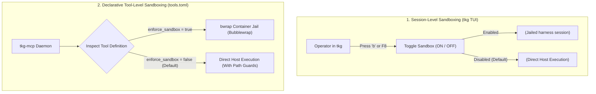

# Configurable Sandboxing & Security Jails

Security in `Torqkage` operates on a **default-deny capability model**. Sandboxing is not hardcoded to force every command into a container; rather, it is a **flexible, opt-in mechanism** configurable at both the interactive session level and the individual tool level.

---

## 1. Two-Tier Sandboxing Architecture

`Torqkage` separates sandboxing into two independent control planes:



### Tier 1: Interactive Session Sandboxing (`tkg`)

In the flight control deck, operators choose whether to isolate the launched agent harness session:
- Press <kbd>b</kbd> or <kbd>F8</kbd> to toggle `Terminal Sandbox ENABLED (bwrap jail)` vs `DISABLED (direct host)`.
- When **ENABLED**, `tkg` passes the configured harness sandbox flag (or wraps the session), running the agent session inside an isolated container environment.
- When **DISABLED** (default), the harness executes directly on the host, avoiding container overhead for standard development while still benefiting from `tkg-hooks` lifecycle gates and path policies.

### Tier 2: Granular Tool-Level Sandboxing (`tools.toml`)

Individual tools declared in `tools.toml` can independently enforce container execution:

```toml
[tools.disassemble_symbol]
action = "parameterized_command"
command = ["llvm-objdump", "-d"]
enforce_sandbox = true      # Wraps THIS specific tool in a Bubblewrap jail
output_capture = "stdout"

[tools.cargo_check]
action = "static_command"
command = ["cargo", "check"]
enforce_sandbox = false     # Runs directly on host (reusing cargo caches)
```

- If `enforce_sandbox = true` (or `sandbox = true`), `tkg-mcp` dynamically wraps the invocation in `bwrap` via `tkg_common::sandbox::build_bubblewrap_command`.
- If `enforce_sandbox = false` (the default for most tools), the tool executes as a standard host process through `SubprocessSupervisor` with process group isolation and strict timeouts.

### Tier 3: Agent Persona Policies (`AGENT.md`)

Each agent manifest specifies its baseline execution policy via `commandExecutionPolicy`:
- `off` *(Default)*: Direct host command execution is prohibited unless mediated through declarative MCP tools.
- `bwrap_isolated`: Enforces Bubblewrap container sandboxing for all commands.
- `direct_host`: Permits unsandboxed host process execution for local development.

---

## 2. Container Isolation Architecture (`bwrap`)

When container sandboxing is active (either via session toggle or tool declaration), `tkg-common` provisions an ephemeral Linux container namespace using [Bubblewrap](https://github.com/containers/bubblewrap):

```
┌────────────────────────────────────────────────────────┐
│             Bubblewrap Isolation Container             │
│                                                        │
│  [Read-Only System Roots]                              │
│  /usr, /bin, /lib, /lib64, /etc (ro)                   │
│                                                        │
│  [Private Namespaces]                                  │
│  --unshare-all (IPC, PID, Network, UTS, Cgroup)        │
│  --die-with-parent (Orphan prevention)                 │
│  --new-session (Process group isolation)               │
│                                                        │
│  [Network Air-Gapping]                                 │
│  Private loopback (lo), external interfaces unmounted  │
│                                                        │
│  [Credential Masking]                                  │
│  .env, .git/credentials, ~/.ssh mounted to /dev/null   │
│                                                        │
│  [Workspace & Cache Confinement]                       │
│  Workspace root mounted read-write                     │
│  [sandbox].bind_mounts (target, .zig-cache) read-write │
└────────────────────────────────────────────────────────┘
```

### Key Security Invariants

1. **Read-Only System Roots:** System binaries and libraries (`/usr`, `/bin`, `/lib`, `/etc`) are mounted strictly read-only.
2. **Network Air-Gapping:** The container unshares network namespaces (`--unshare-net`) and configures only a loopback interface (`lo`). Tools inside the jail cannot reach external networks or exfiltrate data.
3. **Credential Masking:** Sensitive host paths (`.env`, `.git/credentials`, `~/.ssh`, `~/.gnupg`) are bound to `/dev/null` inside the container.
4. **Cache Bind Mounts:** Build cache directories declared in `project.toml` (`[sandbox] bind_mounts = ["target"]`) are bound read-write so compilers (e.g., `cargo`, `zig`) retain incremental compilation speed without exposing the broader host.

---

## 3. Transparent Nested Container Detection

To prevent container-in-container crashes when running inside Docker, Podman, Kubernetes, or GitHub Actions CI runners, `tkg_common::sandbox::is_inside_outer_sandbox()` dynamically inspects:

1. Environment flags: `TKG_OUTER_SANDBOX=1` (or harness-specific outer-sandbox variables such as `AGY_OUTER_SANDBOX=1`).
2. Container filesystem indicators: `/.dockerenv` or `/run/.containerenv`.
3. Control group paths: `/proc/1/cgroup` containing `docker`, `containerd`, or `kubepods`.
4. Nested PID namespaces: Process namespaces with multiple entries in `/proc/self/status` (`NSpid`).

When existing containerization is detected, `Torqkage` **gracefully bypasses inner `bwrap` calls**, avoiding `EPERM` namespace creation failures while retaining application-level path confinement and permission gates.

---

## 4. Multi-Layered Defense-in-Depth

Even when Bubblewrap sandboxing is turned off, `Torqkage` protects your system through multiple software sentries:

- **Path Confinement (`enforce_workspace_bounds`):** Rejects path traversal attempts (`../`) and out-of-tree symlink escapes.
- **Sensitive File Protection (`ban_dangerous_files`):** Blocks access to SSH keys, `.git` internals, and shell profile files.
- **Manifest Mutation Guard:** Intercepts write operations targeting build files (`Cargo.toml`, `build.rs`, `package.json`).
- **Compiler Circuit Breaker:** Stops infinite compile-fail loops after 2 consecutive strikes.
