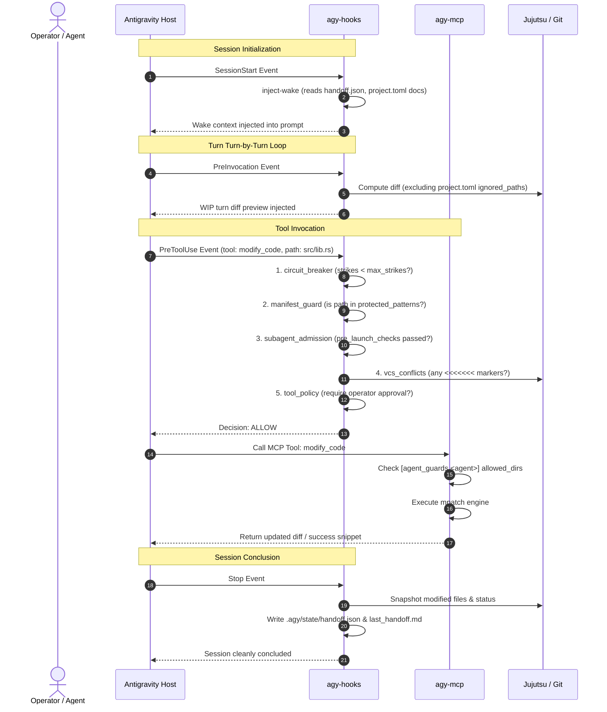

# agy-suite: High-Assurance Systems Programming & Agent Orchestration Plugin

[](LICENSE)
[](https://archlinux.org)
[](https://github.com/martinvonz/jj)

`agy-suite` is an enterprise-grade, high-assurance plugin for Google Antigravity (AGY). It equips autonomous and interactive AI agent fleets with bounded Model Context Protocol (MCP) tooling, deterministic sub-millisecond lifecycle safety hooks, sparse workspace isolation, and an interactive terminal control deck (`agy-ctrl`).

The suite is built around a **zero-hardcoded-assumptions, declarative-first architecture**: all compiler commands, build caches, quality gates, lifecycle hooks, tool permissions, directory boundaries, and security perimeters are defined in transparent, human-editable, self-documenting TOML configuration files.

---

## Table of Contents

1. [Architectural Overview](#architectural-overview)
2. [Plugin File Hierarchy](#plugin-file-hierarchy)
3. [Configuration Files & Lifecycle Roles](#configuration-files--lifecycle-roles)
   - [1. `plugin.json` (Host Manifest)](#1-pluginjson-host-manifest)
   - [2. `hooks.json` (Host Lifecycle Event Map)](#2-hooksjson-host-lifecycle-event-map)
   - [3. `mcp_config.json` (Host MCP Server Config)](#3-mcp_configjson-host-mcp-server-config)
   - [4. `project.toml` (Ecosystem & Quality Gates)](#4-projecttoml-ecosystem--quality-gates)
   - [5. `hooks.toml` (Safety Pipeline & Interceptors)](#5-hookstoml-safety-pipeline--interceptors)
   - [6. `tools.toml` (Declarative MCP Tools & Agent Guards)](#6-toolstoml-declarative-mcp-tools--agent-guards)
4. [How `agents/*.md` Files Interact with `agy-suite`](#how-agentsmd-files-interact-with-agy-suite)
   - [Frontmatter Specification](#frontmatter-specification)
   - [The Air-Gapped Zero-Trust Tooling Model](#the-air-gapped-zero-trust-tooling-model)
   - [Dynamic Pre-Launch Admission Gatekeeping](#dynamic-pre-launch-admission-gatekeeping)
   - [Directory Confinement (`[agent_guards]`)](#directory-confinement-agent_guards)
   - [Sparse Jujutsu Workspace Isolation](#sparse-jujutsu-workspace-isolation)
   - [Fleet Management in `agy-ctrl`](#fleet-management-in-agy-ctrl)
5. [End-to-End Execution Lifecycle Flow](#end-to-end-execution-lifecycle-flow)
6. [Scaffolding & Customization Cookbook](#scaffolding--customization-cookbook)
   - [Adapting to Other Languages (Zig, Go, TS, Python, C/C++)](#adapting-to-other-languages)
   - [Creating a New Specialized Subagent](#creating-a-new-specialized-subagent)
   - [Adding Custom MCP Tools](#adding-custom-mcp-tools)
   - [Adding Custom Shell Assertion Hooks](#adding-custom-shell-assertion-hooks)

---

## Architectural Overview

```
                                 +-------------------------+
                                 |   Antigravity Host UI   |
                                 +------------+------------+
                                              |
                     +------------------------+------------------------+
                     |                                                 |
         [Lifecycle Hook Events]                              [Model Context Protocol]
                     |                                                 |
                     v                                                 v
         +-----------------------+                         +-----------------------+
         |       agy-hooks       |                         |        agy-mcp        |
         |  (Sub-ms Rust engine) |                         |  (Declarative Server) |
         +-----------+-----------+                         +-----------+-----------+
                     |                                                 |
                     | Reads hooks.toml                                | Reads tools.toml
                     | Reads project.toml                              | Reads project.toml
                     | Reads agents/*.md                               | Reads [agent_guards]
                     v                                                 v
        +-------------------------+                       +-------------------------+
        | Safety Pipeline:        |                       | Sandboxed Actions:      |
        | - Circuit Breaker       |                       | - mpatch code editing   |
        | - Manifest Guard (RCE)  |                       | - Scoped documentation  |
        | - Subagent Admission    |                       | - Fast compiler diags   |
        | - Conflict Sentry       |                       | - Bounded ripgrep       |
        | - Interactive Supervise |                       | - Ephemeral JJ workspaces|
        +-------------------------+                       +-------------------------+
                     ^                                                 ^
                     |                                                 |
                     +------------------------+------------------------+
                                              |
                                 +------------+------------+
                                 |        agy-ctrl         |
                                 | (TUI Control Deck &     |
                                 |  Orchestration Console) |
                                 +-------------------------+
```

---

## Plugin File Hierarchy

Within `plugins/agy-suite/` (and its mirrored installation directory `~/.gemini/config/plugins/agy-suite/`):

```
plugins/agy-suite/
├── plugin.json         # Antigravity host plugin manifest (metadata, schema, logo)
├── hooks.json          # Antigravity hook registrations (PreToolUse, PreInvocation, etc.)
├── mcp_config.json     # Antigravity MCP server launch definition (command, args)
├── project.toml        # Declarative ecosystem config (gates, paths, containers, security)
├── hooks.toml          # Declarative lifecycle pipeline rules (circuit breaker, guards)
├── tools.toml          # Declarative MCP tool definitions, inheritance, and agent perimeters
├── README.md           # This comprehensive architecture and configuration manual
├── agents/             # Autonomous agent role specifications (.md markdown with frontmatter)
│   ├── coder.md        # Autonomous implementation agent confined to src/
│   ├── copilot.md      # Chief of Staff coordinating tasks and fleet handoffs
│   ├── finisher.md     # Gatekeeper validating diffs and release readiness
│   ├── mini.md         # Narrow symbolic math and optimization subagent
│   ├── perf-analyst.md # Profiling, assembly, hardware counters, and memory safety
│   ├── planner.md      # Systems architect maintaining ARCHITECTURE.md and docs/
│   ├── spec-checker.md # Read-only auditor cross-referencing specs against code
│   ├── sysadmin.md     # Arch Linux / CachyOS system administrator and troubleshooter
│   └── test-author.md  # Comprehensive test engineer confined to tests/ and benches/
├── bin/                # Self-contained compiled binaries (isolated from project code)
│   ├── agy-mcp         # Declarative MCP stdio server
│   ├── agy-hooks       # High-assurance lifecycle hook handler
│   └── agy-ctrl        # Terminal UI control deck and fleet monitor
└── assets/             # Brand identity, icons, and SVG logos
```

---

## Configuration Files & Lifecycle Roles

### 1. `plugin.json` (Host Manifest)
- **Role:** Registers the plugin with Antigravity.
- **Parser:** Antigravity Host Plugin Loader on startup.
- **Contents:**
  - `name`: Unique plugin identifier (`"agy-suite"`).
  - `version`: Semantic version string.
  - `description`: Human-readable summary of capabilities.
  - `author` & `repository`: Upstream origin metadata.
  - `logo`: Relative path to SVG badge (`"assets/logo.svg"`).

### 2. `hooks.json` (Host Lifecycle Event Map)
- **Role:** Tells the Antigravity engine which shell executables to invoke on specific agent lifecycle events.
- **Parser:** Antigravity Hook Dispatcher.
- **Events Bound:**
  - `PreToolUse`: Triggers `bin/agy-hooks pre-tool-use` before ANY tool call executes. Intercepts calls, checks circuit breakers, guards manifests, and enforces agent admission.
  - `PreInvocation`: Triggers `bin/agy-hooks detect-wip` before each agent turn. Injects turn-by-turn change tracking (diff notices) into the model context.
  - `SessionStart`: Triggers `bin/agy-hooks inject-wake` on turn 1. Injects previous session handoffs, active VCS commit info, and project documentation paths.
  - `Stop`: Triggers `bin/agy-hooks record-handoff` when a session terminates. Saves `.agy/state/handoff.json` and `.agy/state/last_handoff.md`.

### 3. `mcp_config.json` (Host MCP Server Config)
- **Role:** Configures Antigravity to launch the declarative MCP server over `stdio`.
- **Parser:** Antigravity MCP Client Manager.
- **Contents:**
  - Declares the `agy-tools` server:
    ```json
    {
      "mcpServers": {
        "agy-tools": {
          "command": "agy-mcp",
          "args": ["--agent", "copilot"]
        }
      }
    }
    ```
  - Subagents override this via their individual markdown frontmatter to supply `--agent <name>`.

### 4. `project.toml` (Ecosystem & Quality Gates)
- **Role:** The single source of truth for repository structure, language tooling, build caches, quality gates, and documentation paths.
- **Parsers:** `agy-common::ProjectConfig`, `agy-mcp`, `agy-hooks`, `agy-ctrl`.
- **Key Sections:**
  - `[project]`: Name, language (`"rust"`, `"zig"`, `"go"`, `"typescript"`, `"python"`, `"c"`, `"cpp"`), and version.
  - `[workspace]`: `containers` (e.g. `["crates", "packages"]`) and `ignored_paths` (build caches like `["target"]`).
  - `[sandbox]`: `bind_mounts` mapped into the Bubblewrap container jail.
  - `[gates.<name>]`: Declarative quality gates (`compilation`, `tests`, `linter`) specifying `command`, `timeout_seconds`, `failure_message`, `error_regex`, and `explain_command`.
  - `[environment]`: Key-value environment variables injected during tool execution.
  - `[docs]`: `paths` (e.g. `["docs", "ARCHITECTURE.md"]`) and `tool_name` (`"query_project_spec"`).
  - `[security]`: Sensitive file protections (`disabled_categories`, `extra_banned_patterns`, `allowed_patterns`).

### 5. `hooks.toml` (Safety Pipeline & Interceptors)
- **Role:** Configures the native Rust safety interceptors evaluated by `agy-hooks` during agent turns.
- **Parser:** `agy-hooks` sub-millisecond execution engine.
- **Key Sections:**
  - `[pre_tool_use.pipeline]`: Ordered execution chain (`"circuit_breaker"`, `"manifest_guard"`, `"subagent_admission"`, `"vcs_conflicts"`, `"tool_policy"`).
  - `[circuit_breaker]`: `enabled = true`, `max_strikes = 2` (trips mutating tools on repeated compiler errors).
  - `[manifest_guard]`: `enabled = true`, `protected_patterns = ["Cargo.toml", "build.rs", "package.json", ...]` (prevents build-time RCE prompt injection).
  - `[wip]`: `enabled = true`, `max_preview_files = 4` (turn-by-turn change detector).
  - `[session_start]`: `enabled = true`, `inject_wake_state = true`, `inject_documentation = true`.
  - `[stop]`: `enabled = true`, `record_handoff = true`, `max_modified_files = 10`.
  - `[[pre_tool_use.custom_checks]]`: Declarative custom shell commands evaluated without recompiling Rust.

### 6. `tools.toml` (Declarative MCP Tools & Agent Guards)
- **Role:** Declares all MCP tools exposed to agents, base inheritance templates, execution engines, and per-agent blast perimeters.
- **Parsers:** `agy-mcp`, `agy-hooks` (`policy_gate`), `agy-ctrl`.
- **Key Sections:**
  - `[base_tools.<name>]`: Abstract base templates inherited by concrete tools (`code_modifier`, `file_creator`).
  - `[tools.<name>]`: Concrete tool definitions specifying `action`, `category`, `command`, `args`, `output_capture`, `truncate_lines`, `mutating`, `tracks_circuit_breaker`, and `require_permission_gate`.
  - `[agent_guards.<agent>]`: Path boundaries (`allowed_dirs`, `disallowed_dirs`, `allowed_files`) restricting file mutations for each specific agent.

---

## How `agents/*.md` Files Interact with `agy-suite`

Every agent in `plugins/agy-suite/agents/` is a self-contained autonomous actor defined via standard Antigravity Markdown with YAML frontmatter.

### Frontmatter Specification

```yaml
---
name: coder
description: "Autonomous source code implementer that writes production logic in src/"
effort: medium
permissionMode: acceptEdits
commandExecutionPolicy: off
mainAgent: true
subagent: true
tools: []
inheritMcp: false
mcpServers:
  - name: agy-tools
    command: agy-mcp
    args: ["--agent", "coder"]
mcp_tools:
  - read_project_file
  - modify_code
  - write_file
  - search_codebase
  - query_project_spec
  - run_quick_check
  - run_cargo_verification
  - run_cargo_test
  - run_cargo_clippy
pre_launch_checks:
  - compilation
  - tests
---
```

### The Air-Gapped Zero-Trust Tooling Model

1. **`inheritMcp: false`:**
   Prevents the agent from inheriting host tools or parent agent tools. Each agent starts with a blank slate.
2. **`mcpServers` with `--agent <name>`:**
   Instantiates `agy-mcp` with the caller's distinct identity. This binds the MCP server session directly to that agent's security guard in `tools.toml`.
3. **`mcp_tools` Strict Allowlist:**
   `agy-mcp` compares tools declared in `tools.toml` against the agent's frontmatter `mcp_tools`. Any tool NOT in `mcp_tools` is **completely hidden and air-gapped** from the agent's LLM context.
   - Example: `coder` cannot run `run_cargo_semver_checks` or `run_cargo_deny`.
   - Example: `mini` can ONLY see `eval_symbolic_math`.
   - Example: `spec-checker` has zero write or mutate tools.

### Dynamic Pre-Launch Admission Gatekeeping

When Copilot or another agent calls `invoke_subagent` to spawn an agent (e.g. `coder` or `finisher`), the call is intercepted by `agy-hooks pre-tool-use` in the `subagent_admission` pipeline stage:
1. `agy-hooks` extracts the target subagent name from the tool arguments.
2. It parses the target agent's `.md` file frontmatter for `pre_launch_checks: [...]`.
3. It resolves each check against `project.toml` `[gates.<name>]` (e.g. `compilation`, `tests`).
4. If any gate fails:
   - Admission is **DENIED** (`decision: deny`).
   - The subagent is not launched, preventing wasted API tokens.
   - The exact failure diagnostic and error explanation is returned to the calling agent so it can fix the issue.

### Directory Confinement (`[agent_guards]`)

When an agent invokes a file modification tool (`modify_code` or `write_file`), `agy-mcp` inspects `[agent_guards.<name>]` from `tools.toml`:

```toml
[agent_guards.coder]
allowed_dirs = ["src"]
disallowed_dirs = ["tests", "benches", "docs"]

[agent_guards.test-author]
allowed_dirs = ["tests", "benches"]
disallowed_dirs = ["src", "docs"]

[agent_guards.planner]
allowed_dirs = ["docs", ".scratchpad"]
allowed_files = ["ARCHITECTURE.md"]
disallowed_dirs = ["src", "tests", "benches"]
```

If `coder` attempts to alter `tests/common.rs` or `Cargo.toml`, `agy-mcp` blocks the operation with an explicit boundary violation error.

### Sparse Jujutsu Workspace Isolation

To prevent autonomous agents from dirtying the operator's active working copy or triggering file watcher reloads in the operator's IDE:
- Each agent operates in its own sparse Jujutsu workspace located at `.agy/workspaces/<agent_name>/`.
- Tools like `ensure_agent_workspace` and `agy-ctrl` automatically rebase the agent's sparse workspace onto `default@` and symlink the shared build cache (from `project.toml [sandbox.bind_mounts]`).
- Agents commit their changes to distinct change IDs, which can be cleanly absorbed (`jj_absorb_working_copy`) or reviewed before merging.

### Fleet Management in `agy-ctrl`

The `agy-ctrl` TUI provides deep visibility into the agent fleet:
- **Matrix View:** Lists all agents parsed from `agents/*.md` with their role, effort, permission mode, and tool count.
- **In-TUI Live Editing:** Edit any agent markdown specification directly in the TUI.
- **F2 (Save & Validate):** Performs atomic frontmatter validation, schema checks, and tool allowlist verification before saving changes to disk.
- **Direct Launching:** Select any agent and launch an interactive session or headless subagent task with one keystroke.

---

## End-to-End Execution Lifecycle Flow



---

## Scaffolding & Customization Cookbook

### Adapting to Other Languages

To switch `agy-suite` to Zig, Go, TypeScript, Python, or C/C++, simply update `project.toml` with the appropriate ecosystem template:

#### Zig Project Example
```toml
[project]
name = "my-zig-lib"
language = "zig"
version = "0.1.0"

[workspace]
containers = []
ignored_paths = [".zig-cache", "zig-out"]

[sandbox]
bind_mounts = [".zig-cache", "zig-out"]

[gates.compilation]
command = ["zig", "build"]
timeout_seconds = 30
failure_message = "Zig compilation failed (`zig build`)."

[gates.tests]
command = ["zig", "build", "test", "--no-exec"]
timeout_seconds = 45
failure_message = "Zig test compilation failed (`zig build test --no-exec`)."

[docs]
paths = ["docs", "README.md"]
tool_name = "query_project_spec"
```

#### TypeScript / Node Monorepo Example
```toml
[project]
name = "my-ts-app"
language = "typescript"
version = "1.0.0"

[workspace]
containers = ["packages", "apps"]
ignored_paths = [".turbo", "node_modules/.cache", "dist"]

[sandbox]
bind_mounts = [".turbo", "node_modules/.cache"]

[gates.compilation]
command = ["pnpm", "typecheck"]
timeout_seconds = 30
failure_message = "TypeScript typecheck failed (`pnpm typecheck`)."

[gates.tests]
command = ["pnpm", "test", "--run"]
timeout_seconds = 60
failure_message = "Test suite failed (`pnpm test`)."

[docs]
paths = ["docs", "ARCHITECTURE.md"]
tool_name = "query_project_spec"
```

### Creating a New Specialized Subagent

To create a new agent (e.g. `db-migrator`):
1. Create `plugins/agy-suite/agents/db-migrator.md`:
   ```markdown
   ---
   name: db-migrator
   description: "Specialized database migration and schema migration auditor"
   effort: high
   mainAgent: false
   subagent: true
   inheritMcp: false
   mcpServers:
     - name: agy-tools
       command: agy-mcp
       args: ["--agent", "db-migrator"]
   mcp_tools:
     - read_project_file
     - modify_code
     - write_file
     - query_project_spec
   pre_launch_checks:
     - compilation
   ---

   # Directives
   - Confine all schema and migration files to `migrations/`.
   - Always verify backward compatibility of SQL DDL statements.
   ```
2. Add directory boundaries in `tools.toml`:
   ```toml
   [agent_guards.db-migrator]
   allowed_dirs = ["migrations", "docs/schema"]
   disallowed_dirs = ["src", "tests"]
   ```
3. Run `./install.sh --fast` to synchronize the bundle.

### Adding Custom MCP Tools

Add a new tool entry to `plugins/agy-suite/tools.toml`:

```toml
[tools.run_sql_lint]
description = "Lints SQL migration scripts for anti-patterns and performance traps"
action = "parameterized_command"
category = "diagnostics"
command = ["sqlfluff", "lint", "--dialect", "postgres"]
args = [
    { name = "path", required = false, default = "migrations", regex = "^[a-zA-Z0-9_./-]+$", description = "Directory or migration file to lint" }
]
output_capture = "stdout"
truncate_lines = 100
timeout_seconds = 30
```

Add `run_sql_lint` to the `mcp_tools` list of any agent that requires it.

### Adding Custom Shell Assertion Hooks

Add custom declarative pre-tool-use assertions directly in `plugins/agy-suite/hooks.toml` without touching Rust code:

```toml
[[pre_tool_use.custom_checks]]
name = "disk_space_sentry"
matcher = "modify_code|write_file"
command = ["df", "--output=pcent", "."]
fail_if_output_contains = "100%"
decision = "deny"
reason = "Disk space critical: filesystem write operations blocked."
```

---

## Building & Installation

To build and synchronize the plugin bundle to `~/.gemini/config/plugins/agy-suite`:

```bash
# High-speed Cranelift + Mold compilation (Recommended for local dev)
./install.sh --fast

# Optimized standard release build
./install.sh --profile release

# Validate plugin integrity with Antigravity CLI
agy plugin validate ~/.gemini/config/plugins/agy-suite
```
